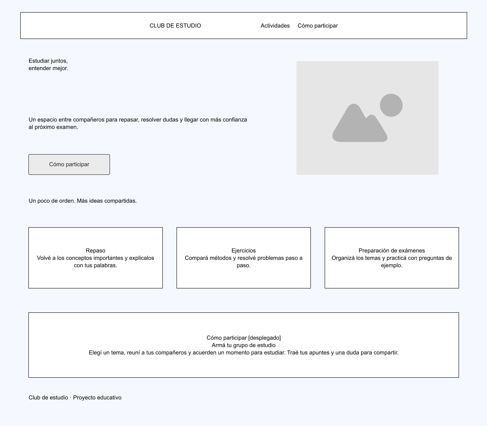
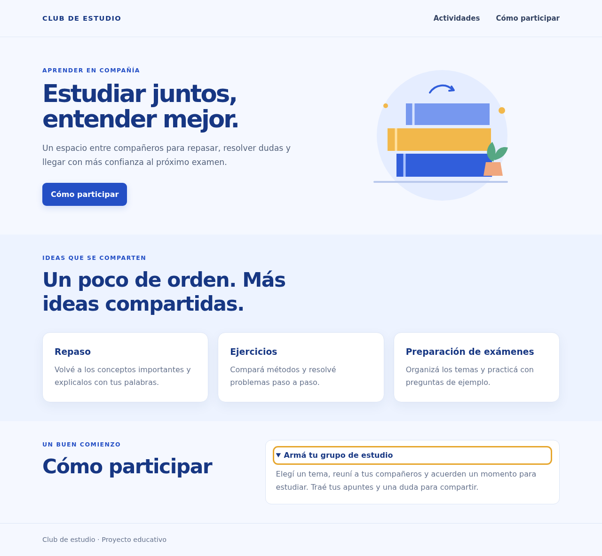
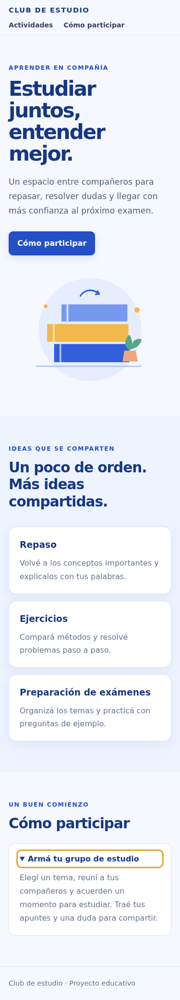

# Landing Page

## 🧩 Datos generales

| Campo | Detalle |
| --- | --- |
| Integrante 1 | Avishag Sadrinas |
| Integrante 2 | No corresponde: trabajo individual |
| Modelos de IA utilizados | GPT-6 Astra y GPT-6 Luna |
| Tecnologías del proyecto | HTML, CSS, SVG, Moqups, Notion y GitHub |
| Link del repositorio | [landing-page](https://github.com/avishagsad/landing-page) |

---

## 📄 Sketch

**Link:** [Primer Sketch - index](https://app.moqups.com/VGdaRsRWB3D5LOnSGKw6bKwwHD9qReS0/view/page/ad64222d5)

**Captura de pantalla:**



El sketch fue creado antes del prompt de implementación e incluye el estado desplegado de Cómo participar.

---

## 💬 Prompts utilizados

**Prompt 1:**

```text
Implementá una landing educativa en español para Club de estudio, basada en el sketch Moqups https://app.moqups.com/VGdaRsRWB3D5LOnSGKw6bKwwHD9qReS0/view/page/ad64222d5 ya creado. Entregá index.html y css/style.css, sin JavaScript ni dependencias externas. Orden: encabezado CLUB DE ESTUDIO con enlaces Actividades y Cómo participar; hero de dos columnas con título "Estudiar juntos, entender mejor.", texto "Un espacio entre compañeros para repasar, resolver dudas y llegar con más confianza al próximo examen.", enlace Cómo participar y una ilustración SVG de libros a la derecha; título "Un poco de orden. Más ideas compartidas."; tres tarjetas: Repaso ("Volvé a los conceptos importantes y explicalos con tus palabras."), Ejercicios ("Compará métodos y resolvé problemas paso a paso."), Preparación de exámenes ("Organizá los temas y practicá con preguntas de ejemplo."); sección Cómo participar con details/summary "Armá tu grupo de estudio" que despliega "Elegí un tema, reuní a tus compañeros y acuerden un momento para estudiar. Traé tus apuntes y una duda para compartir."; footer "Club de estudio · Proyecto educativo". IDs inicio, actividades, participar; clases contenedor, presentacion, tarjetas, tarjeta. Fondo #f5f8ff, azul intenso, fuente del sistema, título grande, bordes suaves, ancho máximo 1100px. En móvil apilar columnas y tarjetas sin desbordamiento. Etiquetas semánticas, foco visible, enlace saltar al contenido, SVG accesible y respeto a movimiento reducido. No inventar horarios ni formularios.
```

**Prompt 2:**

```text
La revisión visual muestra el título de escritorio dividido en cuatro líneas y una página más alta que el boceto compacto. Reducí h1 a clamp(2.5rem, 4vw, 3.25rem), los espacios verticales de las secciones a unos 40px y el hero a 420px de alto mínimo. Quitá los números decorativos de las tarjetas y la flecha del enlace Cómo participar, que no aparecen en el sketch. Conservá todos los textos, el SVG, la navegación y la interacción sin JavaScript; mantené el diseño móvil.
```

**Prompt 3:**

No utilizado: el resultado se completó con dos prompts.

---

## 🔄 Diferencias entre versiones

| Versión | Cambios | Razón |
| --- | --- | --- |
| v1 | Versión base: estructura, estilos, ilustración y desplegable. | Primera versión a partir del sketch. |
| v2 | Título más compacto, menor espacio vertical y eliminación de números decorativos y flecha del enlace. | El título ocupaba cuatro líneas en escritorio y la página era más alta que el boceto; mejorar la fidelidad visual. |
| v3 | No realizada. | No se necesitó otra versión de código. |

---

## Estado del proyecto

- [x] Sketch
- [x] Prompts registrados
- [x] Proyecto funcionando
- [x] Guardado en GitHub

---

## Planeamiento

Objetivo: explicar cómo organizar un grupo de estudio entre compañeros. Público: estudiantes de secundaria.

Orden: encabezado Club de estudio; presentación con ilustración de libros; tres tarjetas Repaso, Ejercicios y Preparación de exámenes; instrucciones Cómo participar.

Interacción: desplegar instrucciones con details y summary, usando únicamente HTML y CSS. Sin formulario de envío. Fondo claro, azul, tipografía del sistema, tarjetas apiladas en móvil.

Archivos: index.html y css/style.css. Identificadores: inicio, actividades, participar. Clases: contenedor, presentacion, tarjetas, tarjeta.

## Pruebas realizadas

Chrome: desplegable con clic, Enter y Espacio; enlaces internos válidos; una sola cabecera principal; tres tarjetas; estilos cargados; ausencia de scripts y errores de página. Sin desbordamiento a 320, 375, 768 y 1280 píxeles. Revisión visual de escritorio y móvil.

Se repitieron las pruebas después de la corrección visual y todas pasaron.

## Cómo ejecutar

Descargar el repositorio y abrir index.html en el navegador; no requiere instalación.

## Evidencias del resultado





El código se publicó primero sin README. El registro de Notion se agregó con el commit Agregamos registro de notion.

